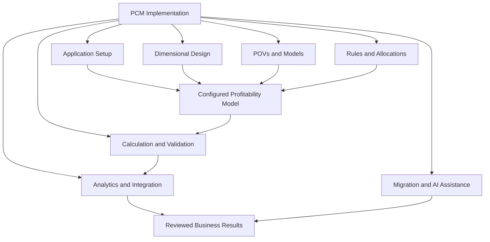
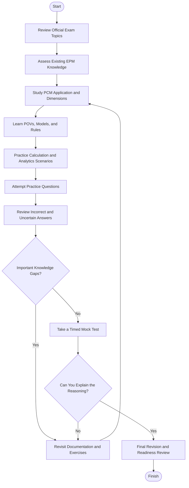
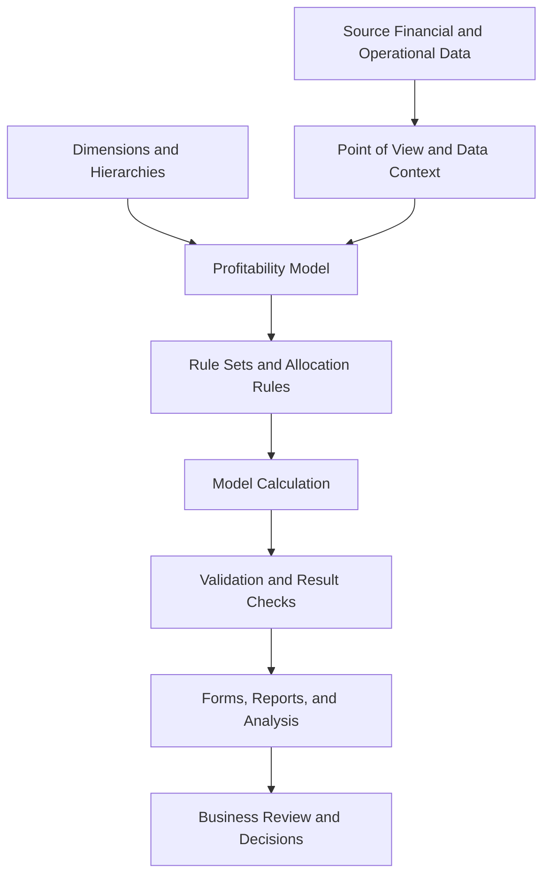
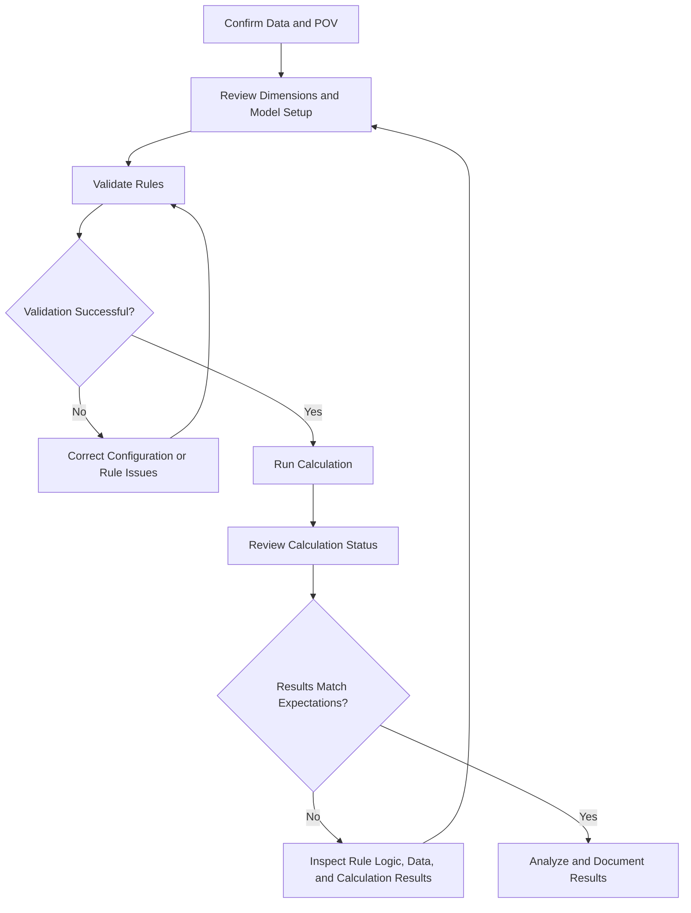
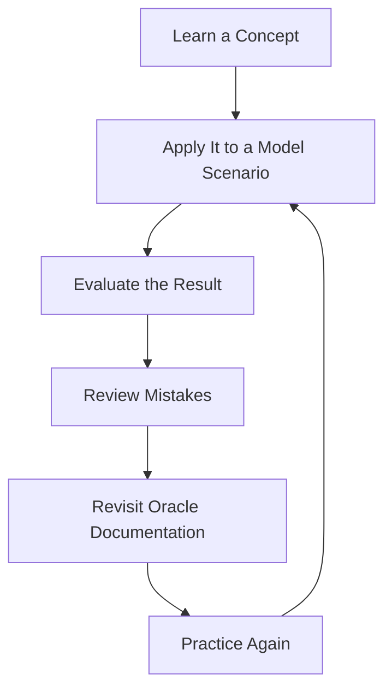
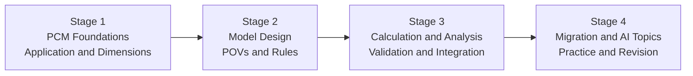

# Oracle Profitability and Cost Management 2026 Implementation Professional (1Z0-1082-26) — Study Guide

A practical study guide for the **Oracle Profitability and Cost Management 2026 Implementation Professional (1Z0-1082-26)** certification. This repository helps learners understand how profitability models are configured, how allocation rules distribute costs and revenue, how calculations are validated, and how results can be analyzed and integrated with other enterprise systems.

The guide organizes the main study areas into a learning roadmap with Mermaid diagrams, original practice questions, illustrative model scenarios, and links to Oracle documentation.

## Table of Contents

- [Overview](#overview)
- [About the Certification](#about-the-certification)
- [Who Should Prepare?](#who-should-prepare)
- [Skills and Knowledge Areas](#skills-and-knowledge-areas)
- [Exam Topics and Objectives](#exam-topics-and-objectives)
- [Conceptual Skills Map](#conceptual-skills-map-not-official-exam-weighting)
- [Certification Preparation Flowchart](#certification-preparation-flowchart)
- [Profitability Model Architecture](#profitability-model-architecture)
- [Model Calculation Workflow](#model-calculation-workflow)
- [Circular Study and Revision Cycle](#circular-study-and-revision-cycle)
- [Step-by-Step Preparation Guide](#step-by-step-preparation-guide)
- [Suggested Study Roadmap](#suggested-study-roadmap)
- [Practice Questions and Mock Tests](#practice-questions-and-mock-tests)
- [Hands-On Projects](#hands-on-projects)
- [Common Preparation Mistakes](#common-preparation-mistakes)
- [Career Relevance](#career-relevance)
- [Frequently Asked Questions](#frequently-asked-questions)
- [Official and Additional Resources](#official-and-additional-resources)
- [About CertsGate](#about-certsgate)

## Overview

Organizations need to understand not only how much they spend, but also where costs originate, which activities consume resources, and how costs and revenue affect the profitability of products, customers, business units, or regions.

Oracle Profitability and Cost Management (PCM) supports this work through allocation models, calculation rules, multidimensional data, and analytical capabilities. A successful implementation requires a clear understanding of the business logic behind a model as well as the application configuration needed to execute it.

This repository focuses on helping candidates:

- Understand PCM application setup and dimensional design.
- Learn how points of view (POVs) and models organize calculation contexts.
- Understand rule sets, allocation rules, and custom calculation rules.
- Validate and troubleshoot model calculations.
- Analyze allocated values and calculation results.
- Review data integration and migration to Enterprise Profitability and Cost Management (EPCM).
- Explore PCM Agent and AI-assisted modeling and performance analysis.
- Practice explaining the reasoning behind a configuration or calculation decision.

## About the Certification

Oracle identifies **1Z0-1082-26** as the exam for **Oracle Profitability and Cost Management 2026 Implementation Professional**. The certification is relevant to professionals implementing and configuring profitability and cost allocation solutions in Oracle Cloud EPM.

| Exam detail | Information |
|---|---|
| Provider | Oracle |
| Certification name | Oracle Profitability and Cost Management 2026 Implementation Professional |
| Exam code | 1Z0-1082-26 |
| Product area | Oracle Cloud Enterprise Performance Management (EPM) |
| Official exam portal | [Oracle University MyLearn](https://mylearn.oracle.com/exam) |
| Technical documentation | [Oracle Profitability and Cost Management](https://docs.oracle.com/en/cloud/saas/profit-cost-cloud/) |
| Exam duration | Secondary exam listings report 90 minutes; verify on the official exam page |
| Question count | Secondary exam listings report 50 questions; verify on the official exam page |
| Passing score | Secondary exam listings report 68%; verify on the official exam page |
| Domain weightings | No verified official percentage breakdown is reproduced in this guide |

The exam details above distinguish reported information from details that should be confirmed directly with Oracle. Exam policies, objectives, and learning materials may change.

## Who Should Prepare?

This certification may be useful for:

- Oracle Cloud EPM implementation consultants.
- Profitability and cost allocation analysts.
- EPM administrators and application specialists.
- Financial planning and management reporting professionals.
- Business analysts working with cost and revenue attribution.
- Consultants responsible for model configuration, calculation, or analysis.
- Professionals working with Oracle PCM or Enterprise Profitability and Cost Management.

A background in financial analysis, management accounting, cost allocation, multidimensional data, or enterprise reporting can help. Candidates who are new to EPM should first become familiar with the purpose of profitability modeling and the relationship between source data, allocation logic, and calculated results.

## Skills and Knowledge Areas

### 1. Application Setup

Understand the purpose of a PCM application and the main considerations involved in creating and configuring it.

### 2. Dimension Design

Study dimensional hierarchies, required dimensions, default members, and design practices that support a maintainable model.

### 3. POVs and Models

Understand how points of view define a data context and how models organize the rules and calculations used to process data.

### 4. Rule Sets and Allocation Rules

Learn how rule sets organize rules, how allocation rules distribute values, and how custom calculation rules support specialized calculations.

### 5. Calculations and Validation

Understand model validation, calculation execution, calculation status, result review, and common troubleshooting approaches.

### 6. Analytics

Review data forms and the use of calculation results, including the PCM_Balance dimension and Rule Balancing, where applicable to the application.

### 7. Data Integration

Understand common integration use cases and the process of configuring and running integrations.

### 8. Migration to EPCM

Review the migration process from Profitability and Cost Management to Enterprise Profitability and Cost Management, including migration templates and post-migration checks.

### 9. PCM Agent and AI Assistants

Study the published topics involving PCM Agent for modeling and calculation and the PCM Agent Performance Assistant for analyzing calculation performance.

These areas are a study organization aid. Use the current Oracle exam objectives as the authoritative checklist.

## Exam Topics and Objectives

The following topic outline is based on publicly available syllabus listings for 1Z0-1082-26. Because the complete current Oracle exam page was not independently confirmed during preparation of this README, verify the wording and coverage in Oracle MyLearn.

| Study area | Concepts and tasks to review |
|---|---|
| Setting Up Profitability and Cost Management | Describe Enterprise Profitability and Cost Management applications; create an application |
| Designing Dimensions | Describe aggregate storage dimension hierarchies; identify required dimensions and default members; explain dimension design best practices; assess designs for scalability, structure, and data management |
| Working with POVs and Models | Manage data POVs; manage models |
| Managing Rule Sets and Rules | Describe rule sets and rules; create rule sets, allocation rules, and custom calculation rules; perform bulk operations for rules |
| Calculating Models | Describe the calculation process; validate models; run calculations; manage and troubleshoot model calculations |
| Analyzing Data | Describe and design data forms for PCM analytics; analyze results in the PCM_Balance dimension; analyze calculation results in Rule Balancing |
| Managing Data Integration | Describe data integration use cases; create data integrations |
| Migrating PCM Applications to EPCM | Describe the migration process; customize the migration template; run migrations; complete post-migration tasks |
| Working with PCM Agent and AI Assistants | Model and calculate with PCM Agent; analyze calculation performance with PCM Agent Performance Assistant |

**Primary references:**

- [Oracle Profitability and Cost Management Documentation](https://docs.oracle.com/en/cloud/saas/profit-cost-cloud/)
- [Oracle Enterprise Profitability and Cost Management Documentation](https://docs.oracle.com/en/cloud/saas/enterprise-profitability-cost-management-cloud/)
- [Oracle University MyLearn](https://mylearn.oracle.com/exam)

## Conceptual Skills Map (Not Official Exam Weighting)

This diagram groups the study areas to show how they relate. It is an independent learning map, not an official exam blueprint, and does not imply equal weighting across topics.

Use this map to connect technical features with business outcomes. For example, an allocation rule is only useful when the dimensional structure, data context, calculation logic, and expected results are understood.

## Certification Preparation Flowchart

A structured preparation process makes it easier to find and resolve knowledge gaps before the exam.

Do not treat completion of a course or practice test as proof that every objective is understood. You should be able to explain the purpose of each model component and reason through unfamiliar allocation or calculation scenarios.

## Profitability Model Architecture

The following diagram illustrates a simplified profitability modeling workflow. It is a conceptual example, not an official Oracle product architecture or a prescribed implementation.

### How the components fit together

- **Source data:** Provides the financial or operational values used by the model.
- **Dimensions:** Organize data by business perspectives, such as account, product, customer, or organizational unit, depending on the design.
- **POV:** Identifies the relevant data context for a model operation.
- **Model:** Organizes the calculation logic and related configuration.
- **Rules:** Define how values are allocated or calculated.
- **Calculation:** Executes the configured model logic.
- **Validation:** Helps confirm that the model and results meet the intended requirements.
- **Analytics:** Supports inspection and interpretation of the calculated results.
- **Business review:** Uses the results to investigate cost drivers and profitability.

The exact dimensions, data structures, and application behavior depend on the product and implementation. Consult Oracle's current documentation before applying this conceptual model to a live environment.

## Model Calculation Workflow

Calculation problems are easier to troubleshoot when the process is broken into clear stages.

When a result looks incorrect, avoid immediately changing the allocation rule. Check the POV, input data, dimension members, rule configuration, and calculation status first. A correct rule can still produce unexpected results if the underlying data or calculation context is wrong.

## Circular Study and Revision Cycle

Use this cycle for each major objective. Repeatedly applying a concept to new examples helps develop understanding beyond simple memorization.

For example, after studying allocation rules, create a small hypothetical cost-allocation example, work through the logic manually, and explain how you would validate the result in PCM.

## Step-by-Step Preparation Guide

### Step 1: Review Oracle's Current Learning Resources

Start with [Oracle University MyLearn](https://mylearn.oracle.com/exam) and locate the current 1Z0-1082-26 exam page and any recommended learning path.

Create a checklist from the official exam objectives. Keep the checklist beside your notes so that study time remains focused on the required subjects.

### Step 2: Understand the Business Purpose of PCM

Before diving into configuration, understand the problem the product solves.

For example, a company may want to understand how shared service costs should be attributed to departments, products, or customers. A profitability model helps represent the logic behind those allocations and analyze the resulting values.

Practice describing the business question first, then identify the data and rules needed to answer it.

### Step 3: Study Application and Dimension Design

Review application creation, aggregate storage dimension hierarchies, required dimensions, default members, and design best practices.

When studying a dimension design, ask:

- What business perspective does this dimension represent?
- How are members organized?
- What role do hierarchies play?
- How might the design affect scalability and data management?
- What should be checked before changing the structure?

Do not assume that every implementation uses the same dimensional structure. Follow the current product documentation and scenario requirements.

### Step 4: Learn POVs, Models, and Rules

Understand how POVs and models are managed and how rule sets organize calculation logic.

Study the differences between allocation rules and custom calculation rules. Focus on their purposes, the situations in which they are used, and how to review their configuration.

A useful learning exercise is to draw a small model on paper, showing the data context, rule sequence, expected inputs, and intended outputs.

### Step 5: Practice Validation and Calculation

Study model validation, calculation execution, result review, and troubleshooting.

Use a repeatable diagnostic process:

1. Confirm the selected data POV.
2. Review the model and dimension configuration.
3. Check the relevant rule sets and rules.
4. Validate the model.
5. Run the calculation in an appropriate learning environment.
6. Review status and results.
7. Investigate unexpected values before changing configuration.

This method helps you distinguish a data issue from a model-design or rule-logic issue.

### Step 6: Review Analytics and Integration

Learn how PCM analytics use data forms and how calculation results can be analyzed through the PCM_Balance dimension and Rule Balancing.

Then review the purpose of data integrations and the configuration steps involved in creating them. Use the current Oracle documentation to confirm the available integration methods and requirements.

### Step 7: Study Migration and AI-Assisted Capabilities

Review the migration process from PCM to EPCM, including the migration template, migration execution, and post-migration tasks.

Also study the listed PCM Agent and AI Assistant topics. Understand what they are intended to help with and how to assess calculation performance using the relevant product features.

Avoid relying on generic AI descriptions alone. Use Oracle's current training and documentation for product-specific behavior.

### Step 8: Test Your Understanding

Use original practice questions and mock tests to identify weak areas.

For each missed or uncertain question:

- Map it to an exam objective.
- Explain why the selected answer was incorrect or uncertain.
- Find the relevant official documentation.
- Rework the scenario using your own notes.
- Try a different example to confirm your understanding.

You can also explore independent preparation material on [CertsGate's 1Z0-1082-26 page](https://certsgate.com/exams/oracle/1z0-1082-26). Treat third-party questions as supplementary study material rather than a substitute for official Oracle resources.

## Suggested Study Roadmap

This four-stage roadmap is an independent preparation recommendation, not an official Oracle timetable.

| Stage | Focus | Practical checkpoint |
|---|---|---|
| 1. Foundations | PCM purpose, application setup, dimensions, hierarchies | Explain the role of application and dimensional design |
| 2. Model design | POVs, models, rule sets, allocation rules, custom calculations | Describe how a model organizes its calculation logic |
| 3. Execution and analysis | Validation, calculations, troubleshooting, analytics, data integration | Explain how you would investigate unexpected results |
| 4. Advanced review | EPCM migration, PCM Agent, AI assistants, mock tests, weak-area review | Explain the migration process and review remaining gaps |

Adjust the pace according to your familiarity with Oracle Cloud EPM and financial modeling. Spend extra time on concepts you cannot explain clearly without notes.

## Practice Questions and Mock Tests

The questions below are original educational examples. They are **not official Oracle exam questions** and are not intended to reproduce the exam.

### Question 1: Dimension Design

A team is designing a profitability model that needs to organize financial data by several business perspectives. Which consideration is most relevant when designing the model's dimensions?

A. Whether the dimension structure supports the required analysis and can be maintained as the model grows.

B. Whether all dimensions have identical member names.

C. Whether the application avoids using hierarchies entirely.

D. Whether every allocation rule uses the same formula.

<strong>Show answer and explanation</strong>

**Answer: A.**

Dimension design should support the intended business analysis, appropriate structure, scalability, and data management. The right design depends on the application requirements; identical structures are not a universal rule.

### Question 2: Allocation Rules

A business wants to distribute a shared cost across several receiving business units using an established allocation method. Which PCM capability is most directly relevant?

A. Allocation rules

B. User interface color settings

C. Exam registration

D. Desktop operating system updates

<strong>Show answer and explanation</strong>

**Answer: A.**

Allocation rules represent the logic used to distribute values according to a model's configuration. The exact rule design depends on the business requirements, source data, dimensional structure, and allocation method.

### Question 3: Unexpected Calculation Results

A model calculation completes, but the resulting values do not match the team's expectations. What is the most sensible next step?

A. Immediately delete the application.

B. Check the POV, input data, model configuration, rule logic, and calculation results.

C. Ignore the result because the calculation completed.

D. Change unrelated dimension members until the result looks correct.

<strong>Show answer and explanation</strong>

**Answer: B.**

A completed calculation does not automatically mean the output matches the intended business logic. Review the calculation context, source data, model configuration, and rules before making changes.

### Question 4: PCM to EPCM Migration

A team is planning to migrate a PCM application to Enterprise Profitability and Cost Management. Which preparation approach is most appropriate?

A. Review the documented migration process, prepare the migration template, run the migration in a suitable environment, and complete post-migration checks.

B. Assume the applications are identical and skip verification.

C. Remove all model documentation before migration.

D. Validate only the user interface and ignore model results.

<strong>Show answer and explanation</strong>

**Answer: A.**

Migration requires understanding the documented process and verifying the resulting application. Review the current Oracle migration instructions for the supported steps and requirements.

### How to Use Practice Questions Effectively

A practice test should reveal what you understand and what still needs work.

- Answer each question before reading its explanation.
- Explain why the selected option fits the scenario.
- Identify why the alternatives are unsuitable.
- Map mistakes to the relevant exam topic.
- Revisit official training material for unclear concepts.
- Use practical exercises to reinforce model behavior.
- Repeat timed tests to evaluate knowledge coverage and pacing.

An unofficial practice score cannot guarantee an exam result. Use practice questions together with objective coverage and a clear understanding of model design, rules, calculations, and analysis.

For supplementary study, visit [CertsGate's Oracle Profitability and Cost Management page](https://certsgate.com/exams/oracle/1z0-1082-26). Verify product-specific claims against Oracle's documentation.

## Hands-On Projects

The following projects are independent study exercises. They are not official Oracle labs or prescribed exam tasks.

### Project 1: Build a Simple Cost Allocation Model on Paper

**Goal:** Understand how allocation logic represents a business requirement.

Imagine a company with a shared support department and three receiving departments.

Tasks:

1. Define the business question the model should answer.
2. Identify the source cost and receiving business units.
3. Describe the dimensions needed to represent the data.
4. Choose a simple hypothetical allocation basis.
5. Calculate the expected distribution manually.
6. Document the assumptions and explain how you would validate the result in PCM.

**Learning outcome:** Explain the relationship between business requirements, data structure, allocation logic, and calculated results.

### Project 2: Design a Dimensional Structure

**Goal:** Practice dimension design and hierarchy reasoning.

Tasks:

1. Choose a hypothetical business with several products and departments.
2. Identify the dimensions required for the intended analysis.
3. Sketch appropriate hierarchies where needed.
4. Describe the role of default members and required dimensions.
5. Consider how the structure might change as the business grows.
6. Record any assumptions that need to be verified against Oracle documentation.

**Learning outcome:** Explain how dimensional design affects the way business data is organized and analyzed.

### Project 3: Create a Calculation Troubleshooting Checklist

**Goal:** Practice a consistent approach to unexpected model results.

Tasks:

1. Confirm the selected POV.
2. Check source data and relevant dimensional members.
3. Review the model and rule configuration.
4. Identify which validation and calculation status information should be inspected.
5. Compare expected and actual results.
6. Document a logical sequence for investigating the discrepancy.

**Learning outcome:** Develop a repeatable troubleshooting approach instead of making unrelated configuration changes.

### Project 4: Plan a PCM-to-EPCM Migration Review

**Goal:** Understand the stages involved in migration planning.

Tasks:

1. Review Oracle's current PCM and EPCM documentation.
2. Identify the documented migration requirements.
3. Review the role of the migration template.
4. Outline the steps that should be checked before and after migration.
5. Identify how model configuration and calculated results should be verified.
6. Record any product-specific details that require confirmation from the official guide.

**Learning outcome:** Explain why migration requires planning and post-migration validation.

> **Environment note:** Use an authorized Oracle Cloud EPM training environment if you want to perform application configuration. Access and available features depend on your subscription, permissions, and environment. Follow Oracle's current instructions before changing a production application.

## Common Preparation Mistakes

### Memorizing terms without understanding the model

Learn how dimensions, POVs, models, and rules work together. A definition is only useful if you can apply it to a scenario.

### Ignoring dimensional design

Poorly understood dimensions can make it difficult to interpret data and reason about calculation results. Review hierarchies, required dimensions, default members, and scalability considerations.

### Treating rule configuration as isolated work

Allocation rules depend on the intended business logic and the data available to the model. Understand the requirement before deciding how it should be represented.

### Skipping validation and troubleshooting

Do not assume a completed calculation necessarily produced the expected business outcome. Practice reviewing the calculation context, rules, status, and results.

### Neglecting analytics

Understanding how to inspect results is an important part of model implementation. Review the published analytics topics, including data forms, PCM_Balance, and Rule Balancing.

### Leaving migration and AI topics until the last moment

EPCM migration and PCM Agent/AI Assistant topics are included in the available syllabus outline. Schedule time to study them rather than concentrating exclusively on allocation rules.

### Relying entirely on third-party questions

Practice questions can identify gaps, but they should not replace Oracle's exam objectives, official training, or product documentation.

## Career Relevance

Profitability and Cost Management knowledge can support work in areas such as:

- Oracle Cloud EPM implementation.
- Financial and management reporting.
- Cost allocation and profitability analysis.
- Enterprise performance management administration.
- Financial systems consulting.
- Business process analysis and decision support.

The practical value of this knowledge comes from understanding the business logic behind the model, implementing that logic carefully, and being able to explain why the calculated results make sense.

Certification can demonstrate focused study, but professional experience, analytical judgment, and continued learning also matter.

## Frequently Asked Questions

### What is the 1Z0-1082-26 certification?

It is the Oracle Profitability and Cost Management 2026 Implementation Professional certification exam. Start with [Oracle University MyLearn](https://mylearn.oracle.com/exam) to find the current exam page and official requirements.

### What does Oracle Profitability and Cost Management do?

Oracle PCM helps organizations model cost and revenue allocations to understand profitability across business segments. Oracle's [product documentation](https://docs.oracle.com/en/cloud/saas/profit-cost-cloud/) explains its functionality and administrative workflows.

### Which topics should I prioritize?

Start with the current official exam objectives. The publicly available syllabus outline used in this guide covers application setup, dimensions, POVs and models, rule sets and allocation rules, calculations, analytics, data integration, migration to EPCM, and PCM Agent/AI Assistant capabilities.

### How long is the exam?

Secondary exam listings report 90 minutes, 50 questions, and a 68% passing score for 1Z0-1082-26. Verify all exam details on the current Oracle MyLearn page before booking.

### Does this repository include official exam questions?

No. The practice questions are original educational examples created to reinforce concepts. They are not represented as official, leaked, or actual exam questions.

### Do I need hands-on experience?

Hands-on work is useful for understanding application setup, allocation rules, calculations, and result analysis. Oracle's current learning path and exam information should guide your preparation choices.

### What is the difference between PCM and EPCM?

Oracle documents Profitability and Cost Management and Enterprise Profitability and Cost Management as distinct business processes. EPCM is a modern implementation of profitability and cost management capabilities with integration across Cloud EPM components. Review the official [EPCM overview](https://docs.oracle.com/en/cloud/saas/enterprise-profitability-cost-management-cloud/pcmpl/about_enterprise_profitability_and_cost_management.html) and current migration documentation for details.

### Can CertsGate replace official Oracle training?

No. CertsGate is an independent preparation resource. Use it for supplementary practice and review, while treating Oracle's current exam information and product documentation as authoritative.

### Does this study guide guarantee a passing result?

No. This repository supports structured learning but cannot guarantee an exam outcome. Use official resources, practice consistently, and assess your ability to explain the concepts behind your answers.

## Official and Additional Resources

| Resource | Purpose |
|---|---|
| [Oracle University MyLearn](https://mylearn.oracle.com/exam) | Find the current 1Z0-1082-26 exam information and learning resources |
| [Oracle Profitability and Cost Management Documentation](https://docs.oracle.com/en/cloud/saas/profit-cost-cloud/) | Review PCM product concepts, setup, administration, and usage |
| [PCM Documentation Books](https://docs.oracle.com/en/cloud/saas/profit-cost-cloud/books.html) | Find administration, usage, migration, integration, and related guides |
| [Oracle Enterprise Profitability and Cost Management Documentation](https://docs.oracle.com/en/cloud/saas/enterprise-profitability-cost-management-cloud/) | Study EPCM concepts and functionality |
| [About Enterprise Profitability and Cost Management](https://docs.oracle.com/en/cloud/saas/enterprise-profitability-cost-management-cloud/pcmpl/about_enterprise_profitability_and_cost_management.html) | Understand EPCM modeling, calculations, and analysis |
| [Oracle Cloud EPM Overview: Profitability and Cost Management](https://docs.oracle.com/en/cloud/saas/enterprise-performance-management-common/cgsus/1_epm_cloud_overview_profit_cs.html) | Review the role of PCM and its relationship to EPCM |
| [CertsGate: 1Z0-1082-26](https://certsgate.com/exams/oracle/1z0-1082-26) | Explore independent certification preparation material |

Use Oracle documentation to verify product behavior and implementation procedures. If a third-party explanation conflicts with current Oracle documentation, investigate the discrepancy before relying on it.

## About CertsGate

[CertsGate](https://certsgate.com/) is an independent IT certification preparation resource. Candidates preparing for Oracle Profitability and Cost Management 2026 Implementation Professional can visit the [1Z0-1082-26 preparation page](https://certsgate.com/exams/oracle/1z0-1082-26) to explore additional practice material.

Third-party resources can help learners review concepts, identify weak areas, and organize practice sessions. They should complement Oracle's official objectives, learning materials, and product documentation rather than replace them.

CertsGate is referenced as an independent resource. This repository does not claim an official partnership with or endorsement by Oracle.

